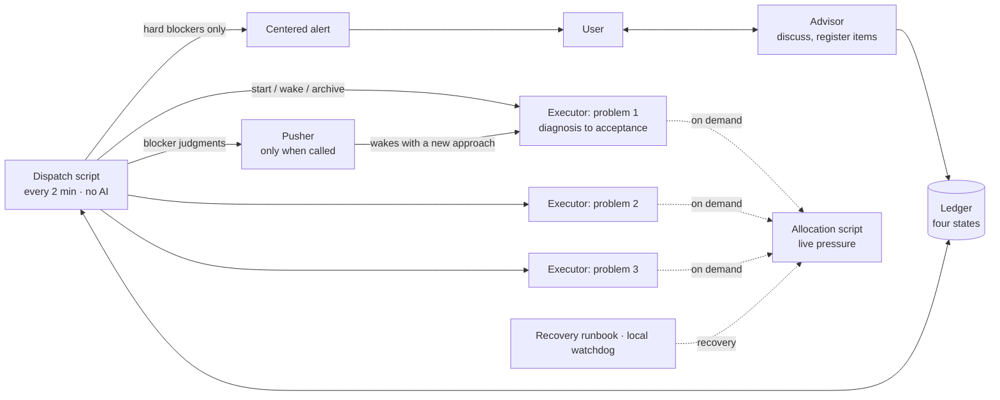

# Reliable Agent Dispatch

[中文](README.md)

**How we coordinate dozens of AI agents in real product development—and the lessons we paid for.**

At APlus, a SketchUp cabinet-design plugin, we run 30–50 AI agents changing code, building, and verifying results in real SketchUp sessions on Mac and Windows, with a release almost every day.

> **2026-11-24, fifth generation.** For four generations, the center of the system was an AI conversation, the lead dispatcher. It woke every 5 minutes, ran the scripts, read the output, and forwarded work orders to executors. When we checked, it had not read the full alert text once in 215 calls, and the only reason it existed was that sub-agents can be woken only by their parent conversation. Now executors are top-level sessions, dispatch is a plain program that runs every 2 minutes, the pusher is called only when a judgment is needed, the user talks to an advisor who registers items, and only hard blockers raise an alert. See **[The Dispatcher Is a Script: Multi-Agent Dispatch, Fifth Generation](docs/en/dispatcher-is-a-script.md)**.

## Five core principles

1. **One independent problem, one top-level session, from diagnosis to acceptance.** Do not replace by stage or split by machine; archive it when done.
2. **Dispatch is a program; only judgment goes to AI.** Starting, waking, archiving, and reconciling are done by a scheduled program. The pusher appears only when the script names a blocker, and wakes the original executor itself.
3. **Restrictive rules must trace to the user's words, and one false block means the check goes.** New gates need user approval; a check that has blocked a normal case is deleted or downgraded to log-only.
4. **Rules that can be scripts become scripts, and the ledger must match reality.** "Shipped" is judged by the code, "resumed" by an actual new turn; machines are granted by live pressure and catch their own failures.
5. **Interrupt people only for hard blockers.** Ordinary decisions follow the recommendation; hard approvals and missing material get an alert that does not disappear on its own; progress stays in the ledger for the advisor to read when asked.

## What is in this repository

| File | Content |
| --- | --- |
| [The Dispatcher Is a Script](docs/en/dispatcher-is-a-script.md) | **Main article (fifth generation)**: dispatch as a program, top-level sessions, listing a role's hidden duties before removing it, alerts only for hard blockers |
| [The Ledger Must Match Reality](docs/en/ledger-meets-reality.md) | Fourth generation: lying statistics, gates hidden in code, the expensive pipeline, the pusher |
| [Put Rules into Scripts; Let Machines Recover Locally](docs/en/scripts-and-self-heal.md) | scripts, machine allocation, recovery |
| [Dispatch skill](skills/reliable-agent-dispatch/SKILL.md) | The skill for an AI assistant to read, in Chinese |
| [Script contracts](skills/reliable-agent-dispatch/references/scripts.md) | Requirements for states, dispatch, stall reports, allocation, recovery, and watchdogs, in Chinese |
| [Quickstart](QUICKSTART.md) | The core principles, in Chinese |
| [Managers Are Shared Services, second version](docs/en/coordination-structure.md) | One thread per problem and the costly lesson of short-context handoffs |
| [Workflow evolution](docs/en/workflow-evolution.md) | How the structure developed, including failures and corrections |
| [Multi-Manager Dispatch Architecture, first version](docs/en/manager-architecture.md) | Historical November 5 version; some rules were superseded by the following versions |
| [Concept map](docs/en/concept-map.md) | Rules mapped to established distributed-systems and engineering-management concepts |

## Using it

Point a skill-capable assistant at [SKILL.md](skills/reliable-agent-dispatch/SKILL.md). Finish a single small problem directly. For multiple independent problems, start an executor per problem and use the [script contracts](skills/reliable-agent-dispatch/references/scripts.md) to implement state handling, dispatch, and machine allocation. First check whether your host lets a program start and wake executors directly; see [host adaptation](skills/reliable-agent-dispatch/references/host-adaptation.md).

This is a skill and field experience, not an execution framework. Queues, message delivery, thread resumption, and machine operations depend on your tools. **Our conditions are a 512,000-token context, about 98% cache hits, tasks lasting hours, and four machines, including two Windows computers also used by the owner.** If yours differ, read section 1 of the second-version article before deciding what to copy.

## How to read the numbers

All figures come from local conversation and resource records, deduplicated by thread and grouped by day in Beijing time. They are observations, not controlled benchmarks; other changes occurred during the same period.

## Earlier versions

> **2026-11-20, fourth generation.** The third generation turned rules into scripts. In the three days after that, three new problems appeared: the statistics lied (27 of 41 "waiting to ship" fixes had already shipped); gates moved from text into code and blocked only normal cases; and once releases ran through a pipeline, each one cost four times the tokens of a manual release. What we do now: the ledger matches reality (code, processes, sessions), not bookkeeping; one false block and the check goes; scripts replace agents instead of giving agents a script to watch; the patroller became a pusher; and the user reads a one-page plain-language status every hour. See **[The Ledger Must Match Reality: Multi-Agent Dispatch, Fourth Generation](docs/en/ledger-meets-reality.md)**.

> **Third version, 2026-11-17.** The second version turned managers into shared services. Over the next five days, the goal became continuous operation while the user slept. We found that our own rules were slowing us down: among 3,383 messages over a little more than a day, agent-created gates such as test-account turn-taking, authorization chains, and extra review produced more messages than real product defects. Now restrictive rules must trace to the user's words; checkable rules belong in scripts; machines are allocated by live pressure; and recovery runbooks and local watchdogs provide the fallback. See **[Put Rules into Scripts; Let Machines Recover Locally: Multi-Agent Dispatch, Third Version](docs/en/scripts-and-self-heal.md)**.

## License

The original skill and documentation are under the [MIT License](LICENSE). This repository has no official affiliation with DeepSeek, Anthropic, or OpenAI; product names describe the context only.
