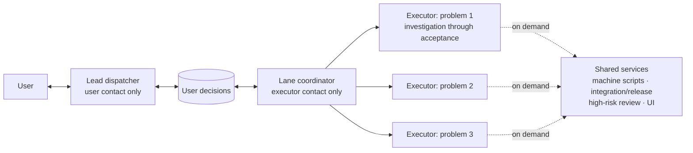

# Reliable Agent Dispatch

[中文](README.md)

**How we coordinate dozens of AI agents in real product development—and the lessons we paid for.**

At APlus, a SketchUp cabinet-design plugin, we run 30–50 AI agents changing code, building, and verifying results in real SketchUp sessions on Mac and Windows, with a release almost every day.

> **Second version, 2026-11-13.** The previous multi-manager architecture grouped work by business area and had managers accept intermediate deliveries. During the following week, with borrowed short-context, stage-handoff practices, management's share of tokens rose from about 13% to 46%–49%, while user-visible updates declined. Now one agent owns a problem through completion, and managers are shared services called when needed. See **[Managers Are Shared Services: Multi-Agent Dispatch, Second Version](docs/en/coordination-structure.md)**.

## Four core principles

1. **One independent problem, one executor, the same thread from investigation through acceptance.** Do not replace by stage or split by machine.
2. **Managers only coordinate.** Bring decisions to the user, pick up stalled lanes, and start integration and release. Machine allocation belongs in scripts.
3. **Track three numbers daily.** Threads per problem (1–2), delivery round trips (no more than 3), and management's share of tokens (our acceptable level is about 30%).
4. **Before borrowing a working method, compare assumptions and run a small pilot.** Libraries and algorithms can be tested directly; working methods may have the opposite effect in another environment.

## What is in this repository

| File | Content |
| --- | --- |
| [Managers Are Shared Services](docs/en/coordination-structure.md) | **Main article, second version:** mistakes, changes, numbers, and what remains unverified |
| [Dispatch skill](skills/reliable-agent-dispatch/SKILL.md) | The skill for an AI assistant to read, in Chinese |
| [Quickstart](QUICKSTART.md) | The core principles, in Chinese |
| [Workflow evolution](docs/en/workflow-evolution.md) | How the structure developed, including failures and corrections |
| [Multi-Manager Dispatch Architecture, first version](docs/en/manager-architecture.md) | Historical November 5 version; some rules have been superseded |
| [Concept map](docs/en/concept-map.md) | Rules mapped to established distributed-systems and engineering-management concepts |

## Using it

Point a skill-capable assistant at [SKILL.md](skills/reliable-agent-dispatch/SKILL.md). Finish a single small problem directly; it needs no manager. For multiple independent problems, start an executor per problem and a lane coordinator to pick up and resume their work.

This is a skill and field experience, not an execution framework. Queues, message delivery, thread resumption, and machine operations depend on your tools. **Our conditions are a 512,000-token context, about 98% cache hits, and tasks lasting hours.** If yours differ, read section 2 of the main article before deciding what to copy.

## How to read the numbers

All figures come from local session records, deduplicated by thread and grouped by day in Beijing time. They are observations, not controlled benchmarks; other changes occurred during the same period.

## License

The original skill and documentation are under the [MIT License](LICENSE). This repository has no official affiliation with DeepSeek, Anthropic, or OpenAI; product names describe the context only.
