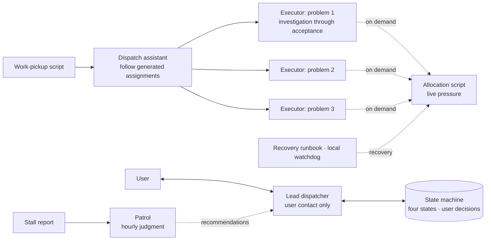

# Reliable Agent Dispatch

[中文](README.md)

**How we coordinate dozens of AI agents in real product development—and the lessons we paid for.**

At APlus, a SketchUp cabinet-design plugin, we run 30–50 AI agents changing code, building, and verifying results in real SketchUp sessions on Mac and Windows, with a release almost every day.

> **Third version, 2026-11-17.** The second version turned managers into shared services. Over the next five days, the goal became continuous operation while the user slept. We found that our own rules were slowing us down: among 3,383 messages over a little more than a day, agent-created gates such as test-account turn-taking, authorization chains, and extra review produced more messages than real product defects. Now restrictive rules must trace to the user's words; checkable rules belong in scripts; machines are allocated by live pressure; and recovery runbooks and local watchdogs provide the fallback. See **[Put Rules into Scripts; Let Machines Recover Locally: Multi-Agent Dispatch, Third Version](docs/en/scripts-and-self-heal.md)**.

## Five core principles

1. **One independent problem, one executor, the same thread from investigation through acceptance.** Do not replace by stage or split by machine.
2. **Restrictive rules must trace to the user's words.** New gates require user approval; remove those with no user basis and no hard boundary to protect.
3. **Put checkable rules into scripts.** Reject missing information and flag omitted work; script work pickup, stall detection, machine allocation, and known-fault repair.
4. **Admit on live machine pressure and recover locally when things go wrong.** Start work, correct estimates from measurements, and return it only under real overload; local watchdogs stop runaway processes.
5. **Track numbers daily; pilot borrowed methods first.** Threads per problem, round trips, management's token share; record friction as it happens; compare assumptions and run a small pilot before adopting another team's methods.

## What is in this repository

| File | Content |
| --- | --- |
| [Put Rules into Scripts; Let Machines Recover Locally](docs/en/scripts-and-self-heal.md) | **Main article, third version:** bottlenecks, gate removal, scripts, machine allocation, recovery, and the friction ledger |
| [Dispatch skill](skills/reliable-agent-dispatch/SKILL.md) | The skill for an AI assistant to read, in Chinese |
| [Script contracts](skills/reliable-agent-dispatch/references/scripts.md) | Requirements for states, work pickup, stall reports, allocation, recovery, and watchdogs, in Chinese |
| [Quickstart](QUICKSTART.md) | The core principles, in Chinese |
| [Managers Are Shared Services, second version](docs/en/coordination-structure.md) | One thread per problem and the costly lesson of short-context handoffs |
| [Workflow evolution](docs/en/workflow-evolution.md) | How the structure developed, including failures and corrections |
| [Multi-Manager Dispatch Architecture, first version](docs/en/manager-architecture.md) | Historical November 5 version; some rules were superseded by the following versions |
| [Concept map](docs/en/concept-map.md) | Rules mapped to established distributed-systems and engineering-management concepts |

## Using it

Point a skill-capable assistant at [SKILL.md](skills/reliable-agent-dispatch/SKILL.md). Finish a single small problem directly. For multiple independent problems, start an executor per problem and use the [script contracts](skills/reliable-agent-dispatch/references/scripts.md) to implement state handling, work pickup, and machine allocation.

This is a skill and field experience, not an execution framework. Queues, message delivery, thread resumption, and machine operations depend on your tools. **Our conditions are a 512,000-token context, about 98% cache hits, tasks lasting hours, and four machines, including two Windows computers also used by the owner.** If yours differ, read section 1 of the second-version article before deciding what to copy.

## How to read the numbers

All figures come from local conversation and resource records, deduplicated by thread and grouped by day in Beijing time. They are observations, not controlled benchmarks; other changes occurred during the same period.

## License

The original skill and documentation are under the [MIT License](LICENSE). This repository has no official affiliation with DeepSeek, Anthropic, or OpenAI; product names describe the context only.
