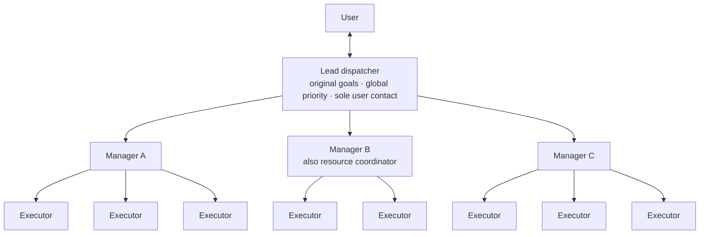

# Reliable Agent Dispatch

[中文](README.md)

**A multi-manager dispatch architecture that keeps dozens of AI agents coordinated in real product development.**

At APlus (a SketchUp cabinet-design plugin), multiple AI agents split the work of changing code, compiling, and verifying results by actually driving SketchUp on Mac and Windows. With a single lead dispatcher, things started to fall apart at about ten execution lines. After adding a manager layer, effective collaboration grew to about fifty lines, with about fifty agents running concurrently and still working smoothly.

## The core idea

**The bottleneck is how many deliveries the lead dispatcher can process per turn, not how many executors there are.** Watchers and reminders only make the backlog visible sooner; they do not process it. The only way to scale is more agents that can process deliveries, so we added a manager layer:

- The **lead dispatcher** talks to the user and holds the original goals and global priority. Routine deliveries do not pass through it.
- **Managers** lead their executors: dispatch, check deliveries, follow up, and chase each user problem to real acceptance.
- A **resource coordinator**, one manager doubling up, allocates machines centrally so that nobody rushes the same machine based on the same idle snapshot.
- **Integration** is also split into parallel lanes by file set, because once execution runs in parallel, a single integration owner becomes the next bottleneck.

The full write-up is **[Multi-Manager Dispatch Architecture](docs/en/manager-architecture.md)**: the six rules that keep it from falling apart, results, costs, and what is not yet verified.

## What is in this repository

| File | Language | Content |
| --- | --- | --- |
| [Multi-manager architecture](docs/en/manager-architecture.md) | English | **Main article**: why a layer, structure, rules, results, and costs |
| [How the workflow took shape](docs/en/workflow-evolution.md) | English | How the structure was found step by step, failures included |
| [Concept map](docs/en/concept-map.md) | English | Each rule mapped to established practice, and what is specific to agents |
| [SKILL.md](skills/reliable-agent-dispatch/SKILL.md) | 中文 | The skill itself, for an AI assistant to read |
| [Manager and integration rules](skills/reliable-agent-dispatch/references/manager-hierarchy.md) | 中文 | Grouping, capacity, resource allocation, integration lanes |
| [Other references](skills/reliable-agent-dispatch/references/) | 中文 | Class-wide defect remediation (largely led by Codex in practice), mature-library proposals, communication, templates, host adaptation |

## Using it

Point a skill-capable assistant at [SKILL.md](skills/reliable-agent-dispatch/SKILL.md), or say: "Read the dispatch skill in this repository and move this batch of tasks forward within the existing authorization."

A single small problem does not need managers; just finish it. Group work only when there are several independent lines and deliveries are actually piling up. Start with two managers leading two or three executors each, and first verify with two small tasks that your tools really deliver results to managers and let them continue the work.

This is a skill plus field notes, not an execution framework. Queues, message delivery, resumption, and machine operations must be provided by the tools you use.

## How to read the numbers

"From about ten lines to about fifty" and "several weeks of work, first round done in a little over three hours" are the owner's observations in practice, not controlled benchmarks. A roughly fivefold increase in collaboration scale does not mean five times the output per unit of time. Ten lines per manager was this round's tested configuration, not a limit.

## Background

Claude was the lead dispatcher at first; later Codex took over. The owner revised these rules through repeated use and correction. We would like to discuss with the DeepSeek Harness team and others:

1. After switching dispatcher tools, how do you verify that deliveries are not dropped?
2. How should agent slots, machine load, file write ownership, and desktop focus be scheduled separately?
3. How do you recognize real progress while avoiding endless review and repeated testing?

Issues and discussions in English are welcome. This repository has no official affiliation with DeepSeek, Anthropic, or OpenAI; product names only describe the context.

## License

The original skill and documentation are under the [MIT License](LICENSE). Linked third-party content remains under its own licenses; no third-party implementation is copied here.
