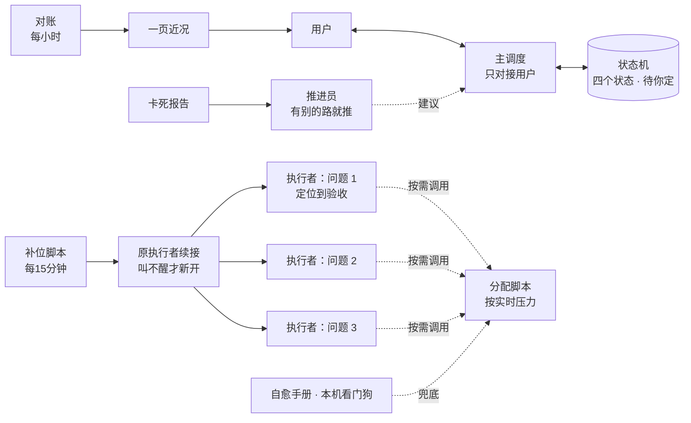

# Reliable Agent Dispatch

[English](README.en.md)

**一个人带几十个 AI 代理做真实产品开发时，我们摸索出来的调度方式，以及交过的学费。**

我们在 APlus（SketchUp 柜体设计插件）的开发中，让 30–50 个 AI 代理分工改代码、编译，并在 Mac 和 Windows 的 SketchUp 里实机验证，几乎每天发一版。

> **2026-11-20 第四版。** 第三版把规矩写成了脚本。之后三天又冒出三个问题：统计在说谎（41 条“待发版”里 27 条早就发了）；门槛从文字搬进代码，拦的全是正常情况；发版改成流水线后，每版 token 反而是手工发版的四倍。现在的做法：账本对上实物（代码、进程、会话），不对登记；误拦一次就拆；脚本替代代理，而不是让代理盯着脚本；巡检升级为推进员；用户每小时看一页人话近况。详见 **[账本要对上实物：多代理调度第四版](docs/ledger-meets-reality.md)**。

## 五条核心

1. **一个独立问题交给一个执行者，同一线程从定位做到验收。** 不按阶段换人，不按机器拆。
2. **限制性规矩要能指到用户原话，误拦一次就拆。** 新增门槛要用户批准；拦过正常情况的检查删掉或降成只记录。
3. **能写成脚本的写成脚本，脚本的账要对上实物。** “已发”看代码，“已唤回”看实际开工；能直接修的不要只报红。
4. **机器按实时压力放行，出了事由机器自己兜底。** 先放进去，按实测纠正，真过载再退回；失控进程由本机看门狗掐掉。
5. **每天看数，用户每小时看一页近况。** 每个问题几个线程、来回几次、管理类 token 占比、发版 token；摩擦当轮记账；借方法先试跑。

## 仓库里有什么

| 文件 | 内容 |
| --- | --- |
| [账本要对上实物：多代理调度第四版](docs/ledger-meets-reality.md) | 第四版新增：账本对上实物、误拦一次就拆、一版一人做到底。 |
| [规矩写成脚本，机器自己兜底](docs/scripts-and-self-heal.md) | 规矩写成脚本、机器分配、自愈 |
| [调度技能](skills/reliable-agent-dispatch/SKILL.md) | 给 AI 助手读的技能本体 |
| [脚本合同](skills/reliable-agent-dispatch/references/scripts.md) | 状态机、补位、卡死报告、机器分配、自愈、看门狗该满足什么 |
| [核心速读](QUICKSTART.md) | 五分钟看懂骨架 |
| [经理是公共设施（第二版）](docs/coordination-structure.md) | 一个问题一个线程做到底；短上下文交接的学费 |
| [演进文章](docs/workflow-evolution.md) | 这套结构一步步试出来的过程，失败和修正都保留了 |
| [多经理调度架构（第一版，历史）](docs/manager-architecture.md) | 11-05 的版本，部分规则已被后两版推翻 |
| [规则与成熟概念对照](docs/concept-map.md) | 每条规则在分布式系统和工程管理里对应什么 |

## 怎么用

让支持技能的助手读取 [SKILL.md](skills/reliable-agent-dispatch/SKILL.md)。单个小问题直接做完就行。有多个互不依赖的问题时，一个问题开一个执行者；再按 [脚本合同](skills/reliable-agent-dispatch/references/scripts.md) 把状态、补位和机器分配做成脚本。

这是一套技能和经验，不是执行框架。队列、消息投递、线程恢复和机器操作，都要靠你所用的工具实现。**我们的条件是 51.2 万上下文、约 98% 缓存命中、单个任务几小时、四台机器（其中两台 Windows 也是用户自己在用的电脑）。** 你的条件不一样的话，请先读第二版主文第一节，再决定照搬哪些。

## 数字的口径

所有数字都来自我们本机的会话和资源记录，按线程去重、按北京时间分日统计。都是实际观察，不是受控基准，同期还有别的干扰。

## 历史版本

> **2026-11-17 第三版。** 第二版把经理改成了公共设施。之后的五天，目标变成“用户去睡觉，系统自己连续跑”。这期间发现，拖慢我们的大多是自己加的规矩：一天多 3383 条消息里，测试账号轮流用、授权链、额外审查这几类代理自加的门槛，比真实产品缺陷还多。现在的做法是：限制性规矩要能指到用户原话；能写成脚本的写成脚本；机器按实时压力分配；出了事由自愈手册和本机看门狗兜底。详见 **[规矩写成脚本，机器自己兜底：多代理调度第三版](docs/scripts-and-self-heal.md)**。

## 许可

本仓库原创技能与说明采用 [MIT 许可](LICENSE)。本仓库与 DeepSeek、Anthropic、OpenAI 均无官方关联，产品名只用于说明使用背景。
