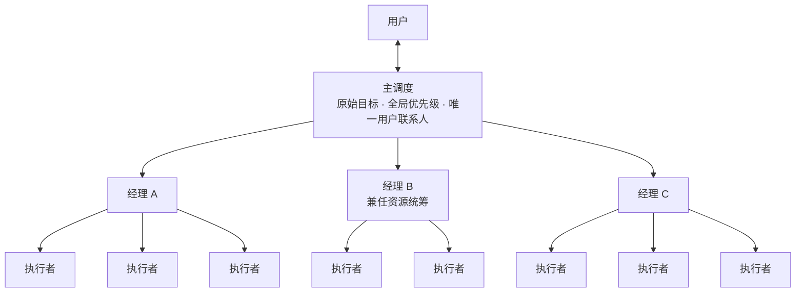

# Reliable Agent Dispatch

[English](README.en.md)

**一套让几十个 AI 代理在真实产品开发里协作不散架的多经理调度架构。**

我们在 APlus（SketchUp 柜体设计插件）的开发中，让多个 AI 代理分工改代码、编译，并在 Mac 和 Windows 的 SketchUp 里实际操作验证。只有一个主调度时，约十条执行线就开始脱节；引入经理层以后，有效协作扩到约五十条，约五十个代理同时运行仍然顺畅。

## 核心想法

**瓶颈是主调度每一轮能处理多少交付，而不是执行者有多少。** 加巡检、加提醒只能让积压更早被看见，处理不了积压。要扩规模，只能增加能处理交付的人，所以加了经理层：

- **主调度**只对接用户、守住原始目标和全局优先级，日常交付不经过它；
- **经理**带本组执行者，派单、核交付、续派，把每个用户问题追到真实验收；
- **资源统筹**由一位经理兼任，统一分配机器，避免大家按同一张空闲快照抢同一台；
- **集成**也按文件分车道并行，因为执行并行以后，唯一的集成负责人成了下一个瓶颈。

完整说明见 **[多经理调度架构](docs/manager-architecture.md)**，包括六条让它不散架的规则、效果、代价和还没验证的部分。

## 仓库里有什么

| 文件 | 内容 |
| --- | --- |
| [多经理调度架构](docs/manager-architecture.md) | **主文**：为什么分层、结构、规则、效果与代价 |
| [调度技能](skills/reliable-agent-dispatch/SKILL.md) | 给 AI 助手读的技能本体，可直接使用 |
| [核心五条速读](QUICKSTART.md) | 五分钟看懂技能骨架 |
| [演进文章](docs/workflow-evolution.md) | 这套结构是怎么一步步试出来的，失败和修正都保留了 |
| [经理制与集成细则](skills/reliable-agent-dispatch/references/manager-hierarchy.md) | 分组、容量、资源分配、集成车道的具体规则 |
| [规则与成熟概念对照](docs/concept-map.md) | 每条规则在分布式系统和工程管理里对应什么，以及多代理场景的不同之处 |

配套实践（与架构配合使用，可按需取用）：

- [止血线与类治理线](skills/reliable-agent-dispatch/references/bug-by-class.md)：一个缺陷既做最小修复，也把同类入口一起关住。这部分实践主要由 Codex 带领推进。
- [成熟库评估提议](skills/reliable-agent-dispatch/references/mature-libraries.md)
- [主调度与人的协作](skills/reliable-agent-dispatch/references/communication.md)
- [派单和交付模板](skills/reliable-agent-dispatch/references/templates.md)、[虚构接续示例](examples/handoff.md)
- [宿主工具适配与验证](skills/reliable-agent-dispatch/references/host-adaptation.md)
- [与 DeepSeek Super-agent 公开原型的对照](docs/superagent-comparison.md)

## 怎么用

让支持技能的助手读取 [SKILL.md](skills/reliable-agent-dispatch/SKILL.md)，或者直接说：“读取本仓库的调度技能，在现有授权范围内推进这批任务。”

单个小问题不需要经理，直接做完就行。有多条独立执行线、交付确实积压了，再分组。建议从两位经理、各带两三个执行者开始，先按[宿主适配说明](skills/reliable-agent-dispatch/references/host-adaptation.md)用两个小任务验证你的工具能真正送达交付和续派任务。

这是一套技能和经验，不是执行框架。队列、消息投递、恢复执行和机器操作都要靠你所用的工具实现。

## 数字的口径

“约十条到约五十条”和“几周的工作三个多小时完成首轮”都是负责人的实际观察，不是受控基准。协作规模扩大约五倍，不等于单位时间产出也是五倍。每位经理带十条是本轮实测配置，不是上限。

## 背景

最初主要由 Claude 做主调度，后来换成 Codex 接续。负责人在反复使用和纠正中修订这些规则。我们希望和 DeepSeek Harness 及其他团队交流：

1. 换主调度工具以后，怎样验证交付不会漏接？
2. 代理名额、机器负载、文件写权和桌面焦点怎样分别调度？
3. 怎样识别实质进展，同时避免无限审查和重复测试？

本仓库与 DeepSeek、Anthropic、OpenAI 均无官方关联，产品名只用于说明使用背景。

## 许可

本仓库原创技能与说明采用 [MIT 许可](LICENSE)。链接指向的第三方内容仍遵守各自许可，本仓库没有复制其实现。
