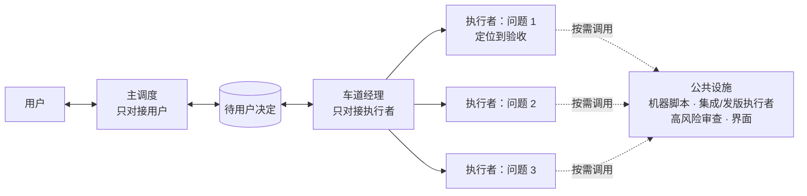

# Reliable Agent Dispatch

[English](README.en.md)

**一个人带几十个 AI 代理做真实产品开发时，我们摸索出来的调度方式，以及交过的学费。**

我们在 APlus（SketchUp 柜体设计插件）的开发中，让 30–50 个 AI 代理分工改代码、编译，并在 Mac 和 Windows 的 SketchUp 里实机验证，几乎每天发一版。

> **2026-11-13 第二版。** 上一版的多经理架构，按业务分组、由经理逐步核收交付。照着它往前推的那一周，加上照搬"短上下文、按阶段交接"，管理类 token 从约 13% 涨到 46%–49%，用户看得到的更新反而变少了。现在的结构是：一个问题交给一个代理做到底，经理变成按需调用的公共设施。详见 **[经理是公共设施：多代理调度第二版](docs/coordination-structure.md)**。

## 四条核心

1. **一个独立问题交给一个执行者，同一线程从定位做到验收。** 不按阶段换人，不按机器拆。
2. **经理只做协调。** 把需要用户决定的事送到用户面前；车道停了有人接；拉起集成和发版。机器分配交给脚本。
3. **每天看三个数。** 每个问题用了几个线程（1–2 个）；中途来回几次（不超过 3 次）；管理类 token 占比（我们的可接受线约 30%）。
4. **借别人的工作方法，先对照前提，再小批试跑。** 库和算法拿来就能测；工作方法换个环境可能正好反过来。

## 仓库里有什么

| 文件 | 内容 |
| --- | --- |
| [经理是公共设施](docs/coordination-structure.md) | **主文（第二版）**：摔在哪、改成什么、数字、还没验证的 |
| [调度技能](skills/reliable-agent-dispatch/SKILL.md) | 给 AI 助手读的技能本体 |
| [核心速读](QUICKSTART.md) | 五分钟看懂骨架 |
| [演进文章](docs/workflow-evolution.md) | 这套结构一步步试出来的过程，失败和修正都保留了 |
| [多经理调度架构（第一版，历史）](docs/manager-architecture.md) | 11-05 的版本，部分规则已被第二版推翻 |
| [规则与成熟概念对照](docs/concept-map.md) | 每条规则在分布式系统和工程管理里对应什么 |

## 怎么用

让支持技能的助手读取 [SKILL.md](skills/reliable-agent-dispatch/SKILL.md)。单个小问题直接做完就行，不需要任何经理。有多个互不依赖的问题时，一个问题开一个执行者，再加一位车道经理负责接住和恢复。

这是一套技能和经验，不是执行框架。队列、消息投递、线程恢复和机器操作，都要靠你所用的工具实现。**我们的条件是 51.2 万上下文、约 98% 缓存命中、单个任务几小时。** 你的条件不一样的话，请先读主文第二节，再决定照搬哪些。

## 数字的口径

所有数字都来自我们本机的会话记录，按线程去重、按北京时间分日统计。都是实际观察，不是受控基准，同期还有别的干扰。

## 许可

本仓库原创技能与说明采用 [MIT 许可](LICENSE)。本仓库与 DeepSeek、Anthropic、OpenAI 均无官方关联，产品名只用于说明使用背景。
