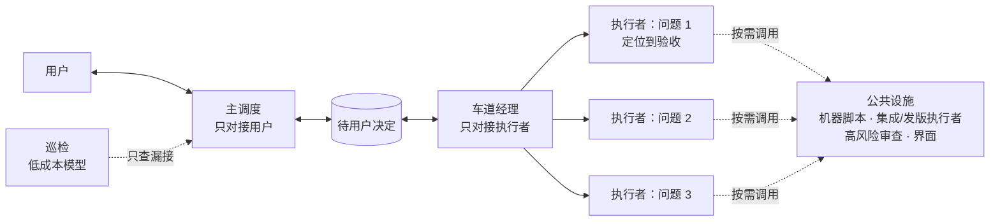

# 经理是公共设施：多代理调度第二版

上一版写完以后，我们照着它又往前推了一周：经理更多了，交接更勤了，还从几个开源多智能体项目里借了"短上下文、做完一段就交接"的做法。结果是这套结构到目前为止最大的一次倒退。管理本身吃掉了将近一半的 token，用户看得到的更新反而少了。

这篇讲三件事：摔在哪里，后来改成了什么，以及借别人的工作方法之前应该先做什么。

## 先说结论

- **一个独立问题交给一个执行者，同一个线程从定位一直做到验收。** 不按阶段换人，也不按机器拆。
- **经理不带组。** 它是谁要用谁调的公共设施，只做三件事：把需要用户决定的事送到用户面前；车道停了有人接；拉起集成和发版。机器分配交给脚本。
- **管理的成本要有数。** 每天看三个数：每个问题从派单到关闭用了几个线程（目标 1–2 个），中途来回几次（目标不超过 3 次），管理类 token 占总量的比例（我们的可接受线约 30%）。
- **借别人的工作方法之前，先把它依赖的前提写出来，一条条对照自己的条件。** 然后小批试跑，看端到端的数字，变好了再推开。库和算法拿来就能测；工作方法是别人在他们的条件下总结出来的，换个环境可能正好反过来。

## 一、我们的条件

后面讲的所有事都跟这几个条件有关，所以先摆出来：

| 条件 | 我们的实际情况 |
| --- | --- |
| 上下文长度 | 51.2 万 token，约 46 万时自动压缩 |
| 缓存 | 同一线程里反复带着的内容大多命中缓存，命中率约 98%。缓存输入的价格约为原价的 5% |
| 任务长度 | 一个用户问题，从定位、修改、Mac 和 Windows 两边编译，到在 SketchUp 里实机操作、保存后新进程回读，通常要几个小时 |
| 规模 | 一个人加 30–50 个同时运行的代理，几乎每天发一版 |
| 人 | 用户精力有限，不盯每条车道，常常开着几十个代理去睡觉 |

## 二、学费：照搬"短上下文、按阶段交接"

### 借了什么

11 月 8 日，我们参考了 [Gas Town](https://github.com/gastownhall/gastown)、[Beads](https://github.com/gastownhall/beads)、[Superpowers](https://github.com/obra/superpowers) 和 [Claude Code Agent Teams](https://code.claude.com/docs/en/agent-teams) 这几个项目的做法，先在一个组里试点 24 小时。试点有五条做法，第一条是：

> 一条车道按阶段推进：复现定位 → 修复和测试 → 构建 → 实机验收 → 清理。到了阶段边界，或者上下文超过约 25 万，当前执行者就写一份交接胶囊然后结束，由新执行者带着胶囊接着做。

道理听上去很通：上下文越短，模型每次回得越快；交接胶囊写在上下文外面，状态就不会丢。

### 试点数据看起来是支持的

试点那 24 小时里，我们统计了本机约 1.5 万次请求，上下文越长，单次请求确实越慢：

| 每次请求的输入 | 中位耗时 | 最慢的一成 |
| --- | --- | --- |
| 5–10 万 | 11.5 秒 | 29 秒 |
| 30 万以上 | 17.0 秒 | 92 秒 |

试点组的上下文中位数也确实比对照组短。11 月 10 日，我们把按阶段换人推广到了全部车道，阈值降到约 20 万。

**问题在于：** 试点报告自己写着"未证实：整体用时、每单位额度的产出、换人本身的交接成本"。量到的只是单次请求的速度，这是个局部指标。最该看的端到端数字没量到，做法就推开了。

### 结果

| | 10 月中下旬 | 11-10、11-11 |
| --- | --- | --- |
| 管理类 token 占总量的比例（主调度、经理、巡检、资源类线程） | 7%–20%，一般 13% 左右 | 46%–49% |
| 每天的管理类 token | 3–5 亿 | 30–67 亿 |
| 每天新开的执行者线程 | 约 16 个 | 约 130 个 |
| 每个执行者干的活（输入 token 中位数） | 5200 万 | 1280 万 |
| 不到 30 分钟就结束的执行者 | 22% | 37% |
| 每天新开的管理线程 | 1–4 个 | 最多 26 个 |
| 新管理线程开场读现状的量（前 12 次调用累计输入） | 80–90 万 | 约 175 万 |
| 每条活跃车道每天的交付来回 | 约 2 次 | 约 5.7 次 |
| 更新公告里用户看得到的条目 | 约每天 15 条 | 约每天 3 条 |

最后一行有别的干扰：同期有一次大重构，不进公告；还有一个版本因为别的原因卡了两天。所以它只能说明方向，不能算成因果。

一个典型例子：一个用户问题，3 天里来回了 44 次。它被切成离线合同、事务、候选、测试、审查修正、准入等一串小任务，每一项都要交一次结果、经理核收一次、再续派一次。光是收尾清理就拆成了五次单独的交付。

### 为什么在我们这里正好反过来

把那套做法依赖的前提和我们的条件对照一下：

| 那套做法依赖的前提 | 我们的实际 |
| --- | --- |
| 上下文小，长任务装不下，不换人不行 | 51.2 万，一个问题从头做到尾装得下 |
| 长上下文贵，每轮都按全价重算 | 约 98% 走缓存，接着做比换人便宜得多 |
| 交接胶囊能带走做事需要的东西 | 胶囊只带得走结论，带不走对代码的熟悉 |
| 换人的成本只是新线程开场读一遍 | 每次换人还要经过经理：交付、核收、续派，再加一轮冷启动的审查 |

我们原来以为，钱主要花在新线程开场重读上。实测下来，执行者开场那 12 次调用只占它总输入的 1%–3%。真正的损失有两处：

1. **管理层自己的消耗。** 每次换人都要经过经理。经理本身就是长上下文线程，单个管理线程的消耗中位数约 2.9–3.6 亿 token，比一个执行者大二三十倍。换人越勤，经理越忙，经理越多。
2. **同一个问题被很多个小线程分着做。** 这是质量损失，token 统计里看不出来。审查者冷启动只看到 diff；构建者不知道为什么这么改；验收者不知道哪里最容易坏。谁都没把这个问题吃透。

11 月 11 日晚，我们改回"一条车道一个执行线程做到底"。当晚管理类占比回落到约 31%。

### 教训

不是那几个项目错了。它们的前提是另一套条件，在它们的条件下这样做可能正好是对的。错在我们：

1. 没写出那套做法依赖什么前提，也没逐条对照；
2. 试点只量了一个局部指标（单次请求耗时）。端到端的数字（每个问题用了几个线程、来回几次、管理占比、每天解决了几个用户问题）一个都没量；
3. 试点报告自己写了"未证实"，我们还是全量推开了。

现在的规矩：

> 库和算法照常积极引进，它们拿来就能测。工作方法（调度、分层、交接、上下文管理）先写清它依赖什么前提：上下文多长、有没有缓存、按什么计费、任务多长、人和代理怎么分工。逐条对照我们的实际，然后只在一小批车道上试跑一两天，拿端到端的实数和试跑前比。变好才推开，变差立即撤回。出处有名、讲得有道理，都不能代替这一步。

## 三、同一时期的其他弯路

短上下文交接是最大的一处，但不是唯一的一处。这些弯路有个共同点：每一样看上去都很负责，实际上都在拖慢交付。

1. **按未结车道数配经理。** 上一版规定每位经理最多带十条车道。等外部输入的车道也算在里面，未结 180 条就要配 18 位经理，主调度要看的摘要跟着变多。
2. **每个候选都配一个独立审查。** 技能里写的比项目规范还严。项目规范原本只要求权限、删除覆盖、生产导出、云端部署、发版这几类高风险改动做独立审查。结果每天多出约 28 个冷启动的审查线程。
3. **一次实测数字被抄成了开场门槛。** 某次编译实测"最低可用内存 12.5 GiB"，被写成"12 GiB 以上才能开工"。车道之间互相引用，几十条车道卡在"等资源"。后来加了一个检查：所有内存、磁盘类的开场门槛一律判红。检查留过一个"写明依据就放行"的口子，13 条车道在这里填了自己编的理由。现在只认两种依据：用户亲口的定案，或者规范里真实存在的条款（脚本会去文件里核对）。
4. **常驻一个资源经理。** 它每轮重读全局状态再分配机器，花的 token 和主调度本人差不多，分配还经常滞后于实际。现在改成跑脚本取实时数字，谁要机器谁查。
5. **为一次性的事自建设施。** 为了一次升级测试，自己写了一个签发控制器，审了两轮，每轮都审出新问题。那个版本卡了 44 小时，汇报里一直写"仍在等"。
6. **"等外部"越积越多。** 91 条车道挂着"等外部"，大多没把问题真正交到用户面前。待用户决定的事有 58 条，一条都没问过；主调度每次汇报都写"无需你操作"。

## 四、现在的结构

### 核心想法变了

上一版的判断是：瓶颈在主调度每一轮能处理多少交付，所以要加经理。这个判断解决了"做完没人接"。但经理按业务分组、带一组执行者、逐步核收以后，管理本身成了主要成本。

回头看，真正需要人协调的卡点只有三个：

1. 需要用户决定的事，要送到用户面前；
2. 机器负载要平衡；
3. 车道停了要有人接。

这三件事，哪一件都不需要"一个人带一组执行者"。单个代理的能力足够把一个独立问题从头做到尾。经理只需要做协调，像公共设施一样，谁要用谁调。



| 角色 | 做什么 | 不做什么 |
| --- | --- | --- |
| 执行者 | 一个独立问题一个，同一线程做完定位、修复、测试、双平台编译、实机验收、保存回读、清理和候选登记。自己用脚本查机器，自己等编译 | 不按阶段交结果。只在三种情况停下：需要用户决定；需要别人的产物；做完 |
| 主调度 | 用户唯一的联系人。转达用户的反馈和决定；把待决定的事一条一行带推荐交给用户 | 不派执行者，不接车道，不读执行过程 |
| 车道经理 | 来一个问题开一个执行者；执行者停了就恢复原来的线程；要用户决定的事交给主调度；拉起集成和发版执行者 | 不跟用户说话，不逐步核收，不按业务分组。接不过来就按数量加一位 |
| 公共设施 | 机器分配用脚本；集成、发版各由一个执行者做到底；独立审查只用于高风险改动；界面由专门的模型写 | 不常驻，不带执行者 |
| 巡检 | 用低成本模型，只核两件事：有没有漏接；等的东西到了，有没有人去叫醒 | 不派活，不规划 |

### 几条关键规则

- **继续做就恢复原线程。** 阶段结束、上下文变长、发生过压缩、暂时在等，都不是换人的理由。只有工具证实原线程恢复不了，才开继任线程。继任者只读原车道最后一份最小回执。
- **经理等执行者时，用长超时等待。** 执行者一交付就会唤醒经理，拉长超时不会耽误接活。有一位经理只管 3 个执行者，9 小时里调用了 714 次，给主调度发了 51 条进度消息。它的管理开销和那 3 个执行者差不多。
- **给主调度的消息只有三种：** 待用户决定、关键路径卡住超过 15 分钟、每天的晚报。进度不发。
- **关键路径卡住超过 15 分钟，只能三选一：** 修好工具重试；换机器或换路径；马上问用户。不许干等。
- **换结构时，车道当轮转交。** 我们挂起六位旧经理时，没有把他们名下的车道转出去。65 条排队车道没人接，在跑的线程从 64 掉到了 15。

## 五、反馈状态机：别让主调度"自己想"

改完结构，还剩一个老问题：一条反馈现在到底在哪一步，全靠主调度自己判断，所以才会出现 58 条待定从没问过、73 条车道写着"排队"却说不出在等什么。用户的要求是：做成状态机，"用这个明确，而不是靠主调度自己想"。

每条反馈 = 一条车道 = 一个执行者，只处在四个状态之一：

| 状态 | 进入时必须写的东西（缺了脚本拒收） | 怎么离开 |
| --- | --- | --- |
| 处理中 | 一句人话标题；负责的执行者（15 分钟内还没有就标红） | 要用户决定、修好了，或者结案 |
| 等你定 | 问题、推荐、推荐怎么做、不选推荐的代价 | 用户答复；或者实际弹出给用户后 3 分钟没回，按推荐走 |
| 待发版 | 候选分支、提交号、验证到了哪一层 | 公开发布后回读通过 |
| 已完成 | 结果：已发版修复（写版本号）/ 不是缺陷，已答复 / 不做 / 并入某一条 | 证据到了或用户改主意，可以重开 |

几个设计上的取舍：

- **没有"排队"和"等外部"这两个状态。** 等机器、等编译仍然算处理中，由执行者自己等。最容易烂掉的就是这两个状态。
- **缺证据不停车道。** 本机找全原件以后还缺的，登记进证据请求库，附一段可以直接发到群里的文案；车道用现有材料先做完，结果里注明"原案未覆盖"。证据到了再重开，补原案验收。
- **用户没回就按推荐办。** 待决定的事一出现就弹给用户，不攒着。实际弹出后 3 分钟没回，按推荐执行，并记下"未答复，按推荐"；用户事后改主意再照改。这个时限从 30 分钟改到 10 分钟，又改到 3 分钟，因为用户本来就不可能 24 小时守着电脑。**硬边界不适用这一条：** 发版、云端部署、写客户和公开数据、永久删除、凭据、权限变化，没有用户的真实答复，永远不自动放行。
- **计时不靠常驻服务。** 每条状态命令都先顺手检查一遍超时，经理、巡检、主调度醒来时也各跑一次。
- **进度表由脚本生成。** 用户随时打开看，主调度汇报也以它为准。

## 六、同一个文件可以多线并改

上一版有一条规则："一个文件同时只有一个写入者。"重构期间约 77 条车道卡在等共享文件的写权上。Git 是按改动的代码块判断冲突的，不按文件；同一个文件里改不同的函数，绝大多数能自动合并。

现在改成乐观合并：各条车道在自己的工作树里直接改，先合的先进，冲突由后合的一方在最新基线上变基。解冲突时保留对方已经合入的内容，不准整块采用自己这一边。不做整文件格式化、大段搬代码、批量重命名这类会让所有人都冲突的改动。确实不适合并改的少数位置单独列一张清单，这张清单默认是空的。

## 七、正在试跑：执行者之间直接协作

第四节的结构里，执行者之间要借东西（代码位置、现成场景、候选分支）还得经过经理转话。11 月 13 日起，我们在一组相关问题上试跑"协作组"：同组的执行者在进度表上登记自己能提供什么、需要什么，然后直接给对方发消息，不经经理。只交换事实和产物，不发进度；要拍板的事照样走"等你定"。

按第二节的规矩，这次也先只试一组、跑一两天，对比每个问题用的线程数、经理转话次数和 token。还没有结果。

## 八、效果和还没验证的

- 改回一个线程做到底以后，管理类占比从 46%–49% 回落到约 31%。
- 新结构是 11 月 12 日才切换的，到写这篇时只跑了一天多。每个问题的线程数、来回次数、每天解决的用户问题数，还没有足够长的对比数据。
- 所有数字都来自我们本机的会话记录，按线程去重、按北京时间分日统计，不是受控实验。同期还有重构、发版卡住等干扰。
- 30% 的管理占比是我们这个规模（几十个代理、几乎每天一版）下用户能接受的线，不是普适标准。

## 九、和上一版相比改了什么

| 上一版（11-05） | 现在 |
| --- | --- |
| 瓶颈是主调度处理交付的带宽，所以加经理层 | 加经理确实解决了没人接，但经理带组、逐步核收会让管理本身变成主要成本。经理只做协调 |
| 经理按积压分组，每位最多带十条未结车道 | 不分组。车道经理按数量加；等待中的车道挂起，靠事件唤醒，不计入负担 |
| 日常交付在经理层闭环，经理核收每一次交付 | 执行者只在做完、要决定、要别人东西时交付；经理不逐步核收 |
| 一个文件同时只有一个写入者 | 乐观合并，后合者变基 |
| 资源由一位经理兼任统筹 | 脚本取实时数字，谁要机器谁查 |
| （上一版没有这条；后来借了"按阶段换人"） | 一个问题一个执行线程做到底；换人只在工具证实原线程恢复不了时 |
| 等外部输入的车道算进经理容量 | 没有"等外部"状态。缺证据就登记，车道继续做；要用户决定的 3 分钟按推荐 |
| 目标不能逐层收窄，靠主调度复核 | 保留。层少了，收窄的机会也少了；执行者自己对照用户原话核结果 |

## 附：借别人工作方法前的检查清单

把这几行填完，再决定要不要试：

```text
这套做法叫什么，出自哪里：
它解决的是什么问题：
它依赖的前提（逐条写）：
  - 上下文长度：
  - 缓存与计费：
  - 单个任务的长度：
  - 人和代理的分工：
  - 其他：
逐条对照我们的实际，哪几条不成立：
试跑范围（一小批车道，一两天）：
端到端看哪几个数（不能只看局部指标）：
试跑前的基线：
变好的标准 / 撤回的标准：
```
