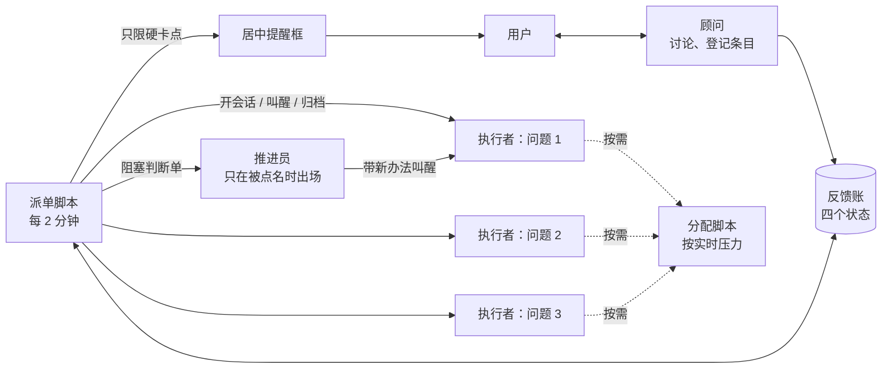

# 调度员换成脚本：多代理调度第五版

[English](en/dispatcher-is-a-script.md)

第四版的结论之一是：脚本要替代代理，而不是让代理盯着脚本。可那时还留着一个例外。整套系统的中心仍是一个 AI 对话，我们叫它“主调度”。它每 5 分钟被唤醒一次，跑一遍脚本，读结果，再把开工单转给各个执行者。

2026-11-24 我们把它拆了。现在派单由一个普通程序负责，每 2 分钟跑一次，全程不经过 AI。

## 先说结论

- **派单交给程序，不交给 AI。** 系统定时任务每 2 分钟跑一次，依次对账、检查、开会话、叫醒原负责人，做完的归档。
- **执行者改成顶层会话。** 子代理只有父对话能叫醒，这就是以前必须养一个 AI 父对话的原因。顶层会话可以由脚本直接开、叫醒和归档。
- **只有要判断的事才叫 AI。** 推进员只在脚本点名时出场，判断完自己去叫醒原负责人，不再转一手。
- **用户找顾问，不找调度。** 用户想交代新任务，跟顾问说，由顾问登记成条目；条目登记好，任务就算下达了。
- **只在硬卡点打扰用户。** 普通取舍按推荐直接办，硬审批和真实缺材料才弹窗；没处理就每 30 分钟再弹一次。
- **拆掉一个角色之前，先把它暗地里干的活列全。** 我们拆完主调度，逐项对照，发现有 7 处没人接。

## 一、让 AI 当触发器，代价是什么

旧结构是这样转的：
1. 5 分钟心跳唤醒主调度。
2. 主调度跑检查脚本，脚本输出两部分：报红全文，和一份可派单清单。
3. 主调度把清单里的开工单原样转给对应的执行者（子代理），再把需要判断的阻塞交给推进员。

问题出在第 2 步和第 3 步之间。我们回查了它的调用记录：**215 次调用里，它一次都没有读报红全文**，只取了派单清单那个字段。脚本早就把问题报出来了，可是一条都没人处理。

当天先修了表面：把阻塞判断单也放进输出，提示词里写明每轮先读完报红全文。但根子在结构上。**让一个 AI 读脚本输出、再转手给别人，本身就多出一个会漏读的环节。** 转手的那一步越机械，越不该交给 AI。

那为什么当初非要一个 AI 不可？因为执行者都是子代理。我们用命令行给闲着的子代理排消息，会被直接拒绝：

```text
direct app-server input is not allowed for unloaded spawned sub-agents
```

能叫醒子代理的，只有它的父对话，也就是那个 AI。这样一来，派单这件纯机械的事，也只能交给 AI 去做。

## 二、别人已经这么做了

这么常见的问题，社区里应该有人解决过。一查，OpenAI 官方公开的 Symphony 规格就是这么设计的：
- 调度器是一段确定性的程序；
- 执行者是 app-server 上的顶层会话；
- 任务看板就是控制面。

社区里也有几个小项目是同一个思路。我们又一次在自己琢磨了很久之后，才发现现成的做法（第二版就写过“先找成熟轮子”）。

照这个思路，我们在本机实测了四个基本动作，全程都没经过 AI：

| 动作 | 做法 | 实测 |
| --- | --- | --- |
| 后台服务 | 宿主自带的 app-server 常驻服务，开机自启，崩溃后自动拉起 | 本地控制口在线 |
| 开会话 | 通过 JSON-RPC 开顶层会话、命名，然后发第一轮开工单 | 约 9 秒跑完第一轮 |
| 叫醒 | 给原会话排一条消息，并要求马上恢复 | 约 10 秒开工 |
| 归档 | 调用归档命令 | 读回确认已归档 |

## 三、现在的结构



| 角色 | 做什么 |
| --- | --- |
| 派单脚本 | 每 2 分钟一轮：对账；检查；按清单开会话或叫醒原负责人；把阻塞判断单送给推进员；把已结案条目的会话归档；有硬卡点就弹提醒框；有待发版候选、又没有在途发版时，自动开一个发版执行者 |
| 执行者 | 一个问题一个顶层会话，从定位做到验收。名字只写一句中文标题，开出来就放进侧栏的同一个分组 |
| 推进员 | 一个常驻会话，只在脚本点名时出场：唤回后仍卡住、红灯 30 分钟没人管、在等用户或等机器。判断完自己叫醒原负责人，交给它新办法 |
| 取证会话 | 白天每小时，脚本先数一遍反馈群有没有新消息，有新消息才叫醒它 |
| 顾问 | 用户自己开的对话，帮用户看情况、分析意图、比较方案。要派活或改方向，就登记条目或写备注 |
| 公共设施 | 机器分配、自愈和看门狗沿用第三、四版的做法 |

几个细节：
- **机械的叫回不经推进员。** 机器空出来了、谁在等都清楚，就由脚本直接叫回原负责人。只有叫回之后仍然卡住，才交给推进员判断。
- **发版不再等人发起。** 以前是主调度看到有全绿候选，就决定开一轮发版。现在由脚本判断：有待发版候选，并且没有在途发版，就开一个发版执行者。热修走同一个入口，排在最前。
- **已有的执行者原样续接。** 旧的子代理停下以后，如果还有下一步，脚本按原开工单开一个顶层继任，同一负责人名下的几条一起交过去，不拆开。

## 四、迁移本身就是一次演示

我们决定一次全部切过去，不搞长期双轨。

第一次，我们让旧主调度自己迁移自己。结果它**两个多小时没往前走**：它的心跳提示词要求每轮尽快结束，可迁移是一件要连续干几十分钟的长活，这件事没有一个专门的负责人。这恰好就是“一个问题一个执行者做到底”要防的那种失败。

第二次，我们开了一个专门的顶层执行者。这个执行者本身就是用新脚本开出来的。它从开工到正式切换用了 **14 分钟**，期间完成了这些事：
- 后台服务开机自启；
- 写好派单脚本；
- 开出推进员和取证两个常驻会话；
- 跑一次隔离试点：开会话、叫醒、归档、推进员叫醒原负责人，都走通了；
- 暂停两个旧心跳。

切换后的第一轮，脚本就自己开出了 3 个执行者。

旧主调度名下还挂着 42 个子代理，其中 24 个手上有没结的条目。我们又开了一个执行者专门迁移它们：有活的按原开工单开顶层会话接手，在检查点交接，不让两边同时写同一个现场；没活的直接关掉。

## 五、拆掉一个角色，先列它暗地里干的活

切换完，我们逐项对照了三样东西：旧心跳的提示词、规矩里提到主调度的 40 处，和新脚本实际做了什么。结果发现有 7 处没人接：

| 原来由主调度顺手做的事 | 处理 |
| --- | --- |
| 发起发版 | 写进脚本：有候选、没在途发版就开 |
| 用户点名的定时汇报（早报、晚报、每小时专项） | **不要了**。用户想了解情况，直接问顾问 |
| 看模型额度，快用完时用免费重置卡 | **不要了**，用户自己管 |
| 机器空出来后叫回等机器的人 | 写进脚本，直接叫回 |
| 收用户的回话 | **不要了**，用户找顾问，由顾问写回条目 |
| 每月按缺陷类别汇总 | 写进脚本：每月 1 日叫推进员做一次 |
| 收旧子代理的回报 | 给旧对话留言：只把结果写回原条目；后续由脚本接续 |

两条教训：
1. **一个角色的职责清单不在它自己的说明里**，而是散落在定时任务的提示词、规矩的角落和大家的习惯里。拆之前要把这些地方都翻一遍。
2. **很多职责其实可以直接删。** 7 处里有 3 处直接删掉了。定时汇报原本是为了让人放心，现在用户想知道时问一句就行。

## 六、只在硬卡点打扰人

脚本发系统通知，横幅几秒钟就收起来了，很容易漏看；真正卡在人身上的事一旦漏看，就可能停上几个小时。

现在的做法：
- **普通取舍按推荐直接办，不通知。**
- **硬卡点才弹窗。** 硬卡点只有两类：硬审批（云端部署、客户或公开数据写入、永久删除、凭据、权限、关机注销），以及真实缺材料。弹的是屏幕中间的提醒框，点了才关；没处理就每 30 分钟再弹一次，几条同时到就合成一个框。
- **进展和结果不推送。** 用户想看的时候问顾问。
- 硬卡点只停那一步，同一条目里其他能做的照常往下推。

手机推送以后再考虑，因为那样消息内容要经过第三方服务器。

## 七、让人看得见：侧栏里的一个分组

脚本开出来的顶层会话，默认不会出现在桌面应用的侧栏里。我们用宿主的官方接口建了一个分组，每开一个会话就自动移进去：
- **分组里有几个会话，就是有几个执行者在干活**；做完归档，它就从分组里消失。
- 会话名只写一句中文标题，不带编号，扫一眼就知道谁在干什么。
- **名字要在开会话时就定好。** 桌面应用和派单用的后台服务是两个进程，事后再改名，桌面要等重启才会刷新。

## 八、规矩文件太长，后半段会被截断

这次顺带发现一件事：我们的项目规矩文件有 41KB，而执行者所用的宿主默认只加载前 32KB。也就是说，**后面那一段规矩，执行者其实从来没读到过。**

处理办法有两条：调大加载上限；把规矩瘦身到 35KB，细则挪进技能的参考文件，规矩里只留指针。

如果你也在用一个很长的规矩文件，先查查你的宿主会加载多少。

## 九、还没验证的

- **省了多少 token。** 切换满 24 小时后，脚本会自动对比切换前后派单类的用量和积压。现在还没有数字，我们不先下结论。
- **后台服务异常退出后的自动恢复。** 已经配好了，但还没真实发生过一次。
- **旧子代理的迁移。** 还在进行中。

## 给想照搬的人

1. 先确认你的执行者能不能被程序直接叫醒。不能的话，你需要一个 AI 父对话当触发器，这一版的大部分做法就用不上。
2. 派单脚本只做机械动作：对账、开会话、叫醒、归档、弹提醒。凡是要判断的，交给一个只在被点名时出场的会话。
3. 拆掉任何一个角色之前，把它的定时任务提示词和规矩里提到它的地方全部列出来，逐条决定是交给脚本、交给人，还是直接删掉。
4. 用户能看见什么，比系统内部多漂亮更重要：给一个分组看在干活的数量，硬卡点用不会自动消失的提醒。
