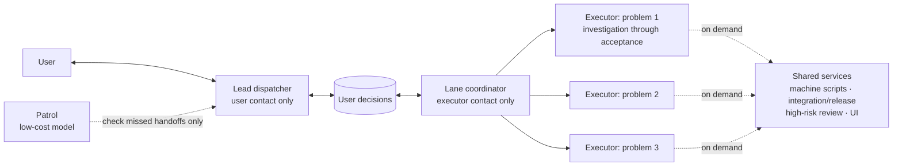

# Managers Are Shared Services: Multi-Agent Dispatch, Second Version

[中文](../coordination-structure.md)

After writing the previous version, we kept using it for another week: more managers, more frequent handoffs, and a borrowed practice from several open-source multi-agent projects—short contexts and handing work over after each stage. The result was our biggest setback so far. Management consumed almost half the tokens, while updates users could actually see became less frequent.

This article covers where we went wrong, what we changed, and what to check before borrowing someone else's working methods.

## Conclusions first

- **Give each independent problem to one executor, in the same thread from investigation through acceptance.** Do not change owners by stage or split the problem by machine.
- **Managers do not lead business groups.** They are shared services, called when needed: bring decisions to the user, make sure stalled lanes are picked up, and start integration and release work. Machine allocation belongs in scripts.
- **Measure management costs.** Track daily: threads used per problem from assignment to closure (target: 1–2), delivery round trips (no more than 3), and management's share of total tokens (our acceptable level is about 30%).
- **Before borrowing a working method, list its assumptions and compare them with your conditions.** Then run a small pilot, measure end-to-end results, and expand only if they improve. Libraries and algorithms can be tested directly; working methods come from someone else's conditions and may have the opposite effect elsewhere.

## 1. Our conditions

Everything below depends on these conditions, so here they are first:

| Condition | Our situation |
| --- | --- |
| Context length | 512,000 tokens; automatic compaction at about 460,000 |
| Cache | Repeated content in the same thread mostly hits the cache, with a hit rate around 98%. Cached input costs about 5% of the uncached rate |
| Task length | A user problem usually takes hours: investigation, changes, Mac and Windows builds, real SketchUp operations, saving, and reopening in a new process to verify |
| Scale | One person and 30–50 concurrent agents, with a release almost every day |
| Human attention | The user cannot watch every lane and often leaves dozens of agents running while asleep |

## 2. The costly lesson: copying short contexts and stage handoffs

### What we borrowed

On November 8, we drew on practices from [Gas Town](https://github.com/gastownhall/gastown), [Beads](https://github.com/gastownhall/beads), [Superpowers](https://github.com/obra/superpowers), and [Claude Code Agent Teams](https://code.claude.com/docs/en/agent-teams), and ran a 24-hour pilot in one group. It had five practices. The first was:

> Advance a lane through stages: reproduction and investigation → fix and tests → build → real-machine acceptance → cleanup. At a stage boundary, or when context exceeds about 250,000 tokens, the current executor writes a handoff capsule and ends. A new executor continues with that capsule.

It sounded reasonable: shorter contexts make each response faster, and keeping the capsule outside the context should preserve state.

### The pilot numbers seemed to support it

Across about 15,000 local requests during those 24 hours, longer contexts did make individual requests slower:

| Input per request | Median duration | Slowest tenth |
| --- | --- | --- |
| 50,000–100,000 tokens | 11.5 seconds | 29 seconds |
| Over 300,000 tokens | 17.0 seconds | 92 seconds |

The pilot group's median context was also shorter than the comparison group's. On November 10, we rolled stage-based replacement out to every lane and lowered the threshold to about 200,000 tokens.

**The problem:** the pilot report itself said that total duration, output per unit of allowance, and the cost of changing owners had not been established. We measured a local metric—request speed—and expanded before measuring the end-to-end results that mattered most.

### What happened

| | Mid-to-late October | November 10–11 |
| --- | --- | --- |
| Management share of total tokens: lead dispatch, managers, patrol, resource threads | 7%–20%, usually around 13% | 46%–49% |
| Management tokens per day | 300–500 million | 3–6.7 billion |
| New executor threads per day | About 16 | About 130 |
| Work per executor, median input tokens | 52 million | 12.8 million |
| Executors ending in under 30 minutes | 22% | 37% |
| New management threads per day | 1–4 | Up to 26 |
| New manager startup reading, cumulative input over the first 12 calls | 800,000–900,000 | About 1.75 million |
| Delivery round trips per active lane per day | About 2 | About 5.7 |
| User-visible items in release announcements | About 15 per day | About 3 per day |

The last row has confounders: a major refactor did not appear in announcements, and a release was delayed for two days for other reasons. It suggests a direction, not causation.

A typical example: one user problem went back and forth 44 times over 3 days. It was split into offline contracts, transactions, candidates, tests, review fixes, admission checks, and other small tasks. Each required delivery, manager acceptance, and another dispatch. Cleanup alone became five separate deliveries.

### Why it worked the other way around for us

Compare the assumptions behind the borrowed practice with our conditions:

| Assumption | Our reality |
| --- | --- |
| Context is small; a long task cannot fit without replacing the executor | At 512,000 tokens, one problem can fit from start to finish |
| Long contexts are expensive because every turn is charged at full price | About 98% hits cache; continuing is much cheaper than changing owners |
| A capsule carries everything needed to continue | It carries conclusions, not familiarity with the code |
| Replacement costs only the new thread's initial reading | Each replacement also passes through a manager: delivery, acceptance, redispatch, plus another cold-start review |

We thought the main cost was initial rereading. In practice, an executor's first 12 calls accounted for only 1%–3% of its total input. The real losses were:

1. **Management's own consumption.** Every replacement went through a manager. Managers were themselves long-context threads, with median consumption around 290–360 million tokens—twenty to thirty times an executor's. More replacement meant busier managers and more managers.
2. **Many small threads dividing one problem.** This was a quality loss that token statistics did not show. The cold-start reviewer saw only the diff; the builder did not know why it changed; the acceptance tester did not know where it was most likely to fail. Nobody knew the whole problem deeply.

On the evening of November 11, we returned to one execution thread per lane through completion. Management's share fell back to about 31% that evening.

### The lesson

Those projects were not wrong. Their assumptions belong to a different set of conditions; the methods may be right there. We made the mistakes:

1. We did not list the assumptions or compare them with our own conditions.
2. The pilot measured only a local metric, request duration. It measured none of the end-to-end numbers: threads per problem, round trips, management share, or user problems solved per day.
3. We rolled it out even though the pilot report explicitly recorded what remained unverified.

Our rule now:

> Keep actively adopting libraries and algorithms: they can be tested. For working methods—dispatch, layering, handoffs, context management—first state the assumptions: context length, cache, billing, task duration, and human-agent division of labor. Compare each with reality. Then pilot on a small set of lanes for a day or two, comparing end-to-end numbers with the baseline. Expand if better, revert if worse. A famous source or a persuasive explanation cannot replace this step.

## 3. Other detours during the same period

Short-context handoffs were the biggest mistake, but not the only one. Each detour looked responsible while slowing delivery.

1. **Assigning managers by open-lane count.** The previous version allowed at most ten lanes per manager, including lanes waiting on external input. With 180 open lanes, that meant 18 managers and more summaries for lead dispatch to read.
2. **Independent review for every candidate.** The skill was stricter than the project rules, which required independent review only for high-risk changes such as permissions, deletion or overwrite, production export, cloud deployment, and release. We added about 28 cold-start review threads per day.
3. **Turning a measurement into a startup gate.** One build's measured minimum of 12.5 GiB became a requirement for more than 12 GiB before starting. Lanes copied it and dozens waited for resources. We later rejected all memory and disk startup gates; an exception for a written justification let 13 lanes invent reasons. Now only explicit user decisions or actual project rules count, and the script checks the referenced rule.
4. **A resident resource manager.** It reread global state and allocated machines each turn, consuming roughly as many tokens as lead dispatch while often lagging reality. Now scripts fetch live numbers, and whoever needs a machine checks them.
5. **Building infrastructure for a one-off task.** We built a signing controller for an upgrade test and reviewed it twice, discovering more issues each time. The release stalled for 44 hours while reports kept saying it was still waiting.
6. **Accumulating external waits.** There were 91 lanes marked as waiting externally, mostly without a real request reaching the user. There were 58 pending user decisions and none had been asked; every lead-dispatch report said no user action was needed.

## 4. The current structure

### The core idea changed

The previous version treated lead dispatch's delivery-processing bandwidth as the bottleneck and added managers. That solved completed work going unclaimed. But when managers grouped executors by business area and checked every intermediate delivery, management itself became the main cost.

There are really only three coordination needs:

1. Bring decisions to the user.
2. Balance machine load.
3. Make sure stalled lanes are picked up.

None requires a person leading a group of executors. An individual agent can take an independent problem from start to finish. Managers only need to coordinate, as shared services called when needed.



| Role | Does | Does not |
| --- | --- | --- |
| Executor | One independent problem, same thread: investigation, fix, tests, platform builds, real-machine acceptance, save/reopen verification, cleanup, candidate registration. Checks machines with scripts and waits for builds itself | No stage-by-stage deliveries. Stops only for a user decision, another executor's artifact or conflict ruling, or completion |
| Lead dispatcher | Sole user contact. Relays feedback and decisions; presents each pending decision with a recommendation | Does not dispatch executors, take over lanes, or read execution logs |
| Lane coordinator | Starts an executor per problem; resumes the original thread when it stops; sends decisions to lead dispatch; starts integration and release executors | Does not talk to the user, accept each intermediate stage, or group by business area. Add another coordinator if needed |
| Shared services | Scripts for machines; one executor each for integration and release; independent review only for high-risk changes; a suitable model for UI | No resident management process, no executor groups |
| Patrol | Low-cost model checks missed handoffs and whether someone resumed work when a dependency arrived | Does not assign work or plan |

### Key rules

- **Resume the original thread.** A completed stage, longer context, compaction, or temporary waiting is no reason to replace it. Start a successor only when tools confirm the original cannot resume. The successor reads the lane's last minimal receipt.
- **Managers wait with long timeouts.** Delivery wakes the manager immediately, so a longer timeout does not delay pickup. One manager with only 3 executors made 714 calls in 9 hours and sent lead dispatch 51 progress messages. Its management overhead was comparable to those 3 executors.
- **Only three message types go to lead dispatch:** pending user decisions, a critical path stalled more than 15 minutes, and the daily evening report. No routine progress messages.
- **After 15 minutes stalled on a critical path, choose:** fix the tool and retry; change machine or route; ask the user immediately. Do not simply wait.
- **Transfer lanes when changing structures.** When we suspended six old managers without transferring their lanes, 65 queued lanes had no coordinator and running threads dropped from 64 to 15.

## 5. Feedback states: make status explicit

After changing the structure, an old problem remained: feedback status still depended on lead dispatch's judgment. That is how 58 decisions went unasked and 73 lanes were marked queued without a clear dependency. The user asked for an explicit state machine rather than relying on the dispatcher to work it out.

Each feedback item = one lane = one executor, in one of four states:

| State | Required information; the state tool rejects incomplete entries | Exit |
| --- | --- | --- |
| Working | A plain-language title and responsible executor; flag if none is assigned within 15 minutes | User decision needed, fixed, or closed |
| Needs your decision | Question, recommendation, proposed action, and cost of choosing otherwise | User answers; or follow the recommendation after 3 minutes without a reply once actually presented |
| Awaiting release | Candidate branch, commit, and verification level | Authorized public release and successful readback |
| Done | Released fix with version / not a defect and answered / not doing / merged into another item | Reopen when evidence arrives or the user changes the decision |

Design choices:

- **No queued or waiting-external states.** Waiting for machines or builds is still Working, handled by the executor. Those labels were where work most easily went stale.
- **Missing evidence does not stop the lane.** Search local originals first; record any remaining request with ready-to-send wording. Finish what existing material supports, explicitly marking the original case as not covered. Reopen for original-case acceptance when evidence arrives.
- **Follow ordinary recommendations when the user does not reply.** Present decisions immediately. After 3 minutes without a reply, record the absence of a reply and proceed; honor later corrections. We shortened this from 30 to 10 to 3 minutes because the user cannot watch the computer 24 hours a day. **Hard boundaries are excluded:** release, cloud deployment, customer or public data writes, permanent deletion, credentials, and permission changes never pass automatically without an actual user answer.
- **No resident timer service.** State commands check timeouts as part of their work; coordinators, patrol, and lead dispatch check when awakened.
- **Generate the progress board from the state tool.** The user can inspect it, and lead dispatch reports from the same source.

## 6. Parallel edits to the same file

The previous version allowed only one writer per file. During refactoring, about 77 lanes waited for shared-file write ownership. Git detects conflicts by changed blocks, not whole files; different functions in the same file can usually merge automatically.

Now we use optimistic merging: each lane edits in its own worktree; the first merge goes in, and later lanes rebase on the latest baseline. Preserve already merged work when resolving conflicts, rather than taking your entire side. Avoid whole-file formatting, large code moves, or bulk renames that make everyone conflict. Keep a separate list for the few locations that genuinely cannot be edited concurrently; it is empty by default.

## 7. In pilot: executors collaborating directly

In the structure above, borrowing code locations, existing scenes, or candidate branches still passes through a manager. Starting November 13, we are piloting a collaboration group for related problems: executors list what they can provide and what they need on the progress board, then message each other directly. They exchange facts and artifacts, not progress reports. Decisions still go through Needs your decision.

Following the lesson in section 2, we are trying only one group for a day or two, comparing threads per problem, manager relay messages, and tokens. There are no results yet.

## 8. Results and what remains unverified

- Returning to one thread through completion brought management's token share from 46%–49% back to about 31%.
- The new structure was introduced only on November 12; at the time of writing it had run for a little over a day. We do not yet have a long enough comparison for threads per problem, round trips, or user problems solved per day.
- All figures come from local session records, deduplicated by thread and grouped by day in Beijing time. This is not a controlled experiment; refactoring and release delays are confounders.
- A 30% management share is what this user accepts at our scale—dozens of agents and almost daily releases—not a universal standard.

## 9. What changed from the previous version

| Previous version, November 5 | Now |
| --- | --- |
| Add managers because lead dispatch's delivery-processing bandwidth is the bottleneck | Managers solved missed pickup, but groups and intermediate acceptance made management a major cost. Managers only coordinate |
| Group the backlog; at most ten open lanes per manager | No business grouping. Add lane coordinators as needed; suspend waiting activity and wake by events rather than counting it as active load |
| Managers close the loop on routine deliveries and accept each one | Executors deliver only when done, needing a decision, or needing someone else's artifact; managers do not accept each stage |
| One writer per file | Optimistic merging; later mergers rebase |
| One manager also coordinates resources | Scripts fetch live numbers; whoever needs a machine checks |
| Not in the first version; stage-based replacement was borrowed later | One execution thread per problem through completion; replace only when tools confirm it cannot resume |
| External waits count toward manager capacity | No waiting-external state. Record missing evidence and keep working; ordinary user decisions follow recommendations after 3 minutes |
| Goals must not narrow through the hierarchy; lead dispatch checks | Keep this. Fewer layers mean fewer opportunities to narrow goals; executors compare results with the user's original words |

## Appendix: checklist before borrowing a working method

Fill this in before deciding whether to try it:

```text
Method and source:
Problem it solves:
Its assumptions, listed individually:
  - Context length:
  - Cache and billing:
  - Duration of an individual task:
  - Human-agent division of labor:
  - Other:
Compare with our conditions; which assumptions do not hold:
Pilot scope: a small set of lanes, a day or two:
End-to-end metrics, not only local measures:
Baseline before the pilot:
Success criteria / rollback criteria:
```
