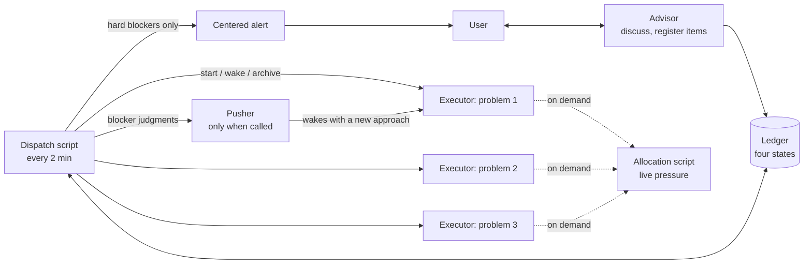

# The Dispatcher Is a Script: Multi-Agent Dispatch, Fifth Generation

[中文](../dispatcher-is-a-script.md)

One conclusion of the fourth generation was that scripts should replace agents, not give agents a script to watch. One exception remained. The center of the system was still an AI conversation we called the lead dispatcher. It woke every 5 minutes, ran the scripts, read the results, and forwarded work orders to executors.

On 2026-11-24 we removed it. Dispatch is now a plain program that runs every 2 minutes, with no AI involved.

## Conclusions first

- **Dispatch is a program, not an AI.** A scheduled system job runs every 2 minutes. It reconciles, checks, starts sessions, wakes original owners, and archives finished ones.
- **Executors are top-level sessions.** A sub-agent can be woken only by its parent conversation, which is why we needed an AI parent before. A program can start, wake, and archive top-level sessions directly.
- **Call an AI only when judgment is needed.** The pusher appears only when the script names a blocker. It then wakes the original owner itself, without a middleman.
- **The user talks to an advisor, not to the dispatcher.** To hand over new work, the user tells an advisor, who registers it as an item. Once the item is registered, the work has been assigned.
- **Interrupt the user only for hard blockers.** Ordinary decisions follow the recommendation. Only hard approvals and genuinely missing material raise an alert, and an unhandled alert reappears every 30 minutes.
- **Before removing a role, list the work it was quietly doing.** After removing the dispatcher, we checked item by item and found 7 duties nobody had picked up.

## 1. What it cost to use an AI as a trigger

The old loop worked like this:
1. A 5-minute heartbeat woke the lead dispatcher.
2. It ran the check script. The output had two parts: the full alert text and a list of work that could be dispatched.
3. It forwarded the work orders on that list, unchanged, to the matching executors (sub-agents), and passed blockers that needed judgment to the pusher.

The problem sat between steps 2 and 3. We went back through its call records: **in 215 calls, it never once read the full alert text.** It only took the dispatch-list field. The script had been reporting the problems all along, and nobody acted on any of them.

That day we fixed the surface: we added the blocker list to the output and told the prompt to read the full alert text first on every round. But the root cause was structural. **Having an AI read script output and pass it to someone else adds a step that can miss things.** The more mechanical the handoff, the less it belongs with an AI.

So why did we need an AI in the first place? Because the executors were sub-agents. Queuing a message from the command line to an idle sub-agent is rejected outright:

```text
direct app-server input is not allowed for unloaded spawned sub-agents
```

Only the parent conversation, the AI, can wake a sub-agent. That forced even purely mechanical dispatch onto an AI.

## 2. Someone had already done it

A problem this common had probably been solved already. It had. OpenAI's public Symphony spec is built this way:
- the scheduler is a deterministic program;
- executors are top-level sessions on the app-server;
- the task board is the control plane.

A few small community projects follow the same idea. Once again, we found the existing approach only after working on our own for a long time (the second generation already said "look for mature solutions first").

Following that approach, we tested four basic operations on our own machine, with no AI involved:

| Operation | How | Measured |
| --- | --- | --- |
| Background service | The host's own app-server service, started at login and restarted after a crash | Local control socket online |
| Start a session | Start a top-level session over JSON-RPC, name it, and send the first work order | First turn finished in about 9 seconds |
| Wake | Queue a message to the original session and ask it to resume | Work started in about 10 seconds |
| Archive | Call the archive command | Read back as archived |

## 3. The structure now



| Role | What it does |
| --- | --- |
| Dispatch script | One round every 2 minutes: reconcile; check; start sessions or wake original owners from the list; send blocker judgments to the pusher; archive sessions whose items are closed; raise alerts for hard blockers; and start a release executor when there are release candidates and no release in progress |
| Executor | One top-level session per problem, from diagnosis to acceptance. Its name is a single short title, and it goes into one sidebar group as soon as it starts |
| Pusher | A resident session that appears only when the script names it: something is still stuck after a wake, an alert has gone unhandled for 30 minutes, or an item is waiting on the user or on a machine. After judging, it wakes the original owner itself with the new approach |
| Intake session | Every hour during the day, the script first counts new messages in the feedback groups and wakes this session only if there are new ones |
| Advisor | A conversation the user opens. It helps the user see the state, work out intent, and compare options. New work or a change of direction becomes an item or a note |
| Shared services | Machine allocation, recovery, and watchdogs work as in the third and fourth generations |

A few details:
- **Mechanical wakes skip the pusher.** When a machine frees up, it is clear who was waiting, so the script wakes that owner directly. Only if the owner is still stuck after the wake does the pusher judge.
- **Releases no longer wait for someone to start them.** The lead dispatcher used to decide to start a release when it saw an all-green candidate. Now the script decides: if there are release candidates and no release in progress, it starts a release executor. Hotfixes use the same entry and go first.
- **Existing executors continue unchanged.** When an old sub-agent stops and there is a next step, the script starts a top-level successor from the original work order, and several items under the same owner move together.

## 4. The migration was itself a demonstration

We decided to switch everything over at once, with no long period of running both.

First, we asked the old lead dispatcher to migrate itself. **It made no progress for more than two hours.** Its heartbeat prompt told it to end every round quickly, but the migration was a long job that needed tens of minutes of continuous work, and no one owned it. That is exactly the failure "one problem, one executor, all the way" is meant to prevent.

Second, we started a dedicated top-level executor, itself started by the new script. **14 minutes** after it began, the cutover was done. In that time it:
- made the background service start at login;
- wrote the dispatch script;
- started the resident pusher and intake sessions;
- ran an isolated pilot in which starting, waking, archiving, and the pusher waking an original owner all worked;
- paused the two old heartbeats.

In the first round after the cutover, the script started 3 executors on its own.

The old dispatcher still had 42 sub-agents, and 24 of them were holding open items. We started another executor just to migrate them. Those with work get a top-level session from their original work order, with the handoff made at a checkpoint so two sides never write to the same workspace at once. Those without work are closed.

## 5. Before removing a role, list the work it was quietly doing

After the cutover, we compared three sources item by item: the old heartbeat prompts, the 40 places our rules mentioned the lead dispatcher, and what the new script actually does. Seven duties had no owner:

| What the lead dispatcher used to do in passing | Now |
| --- | --- |
| Starting releases | In the script: start one when there are candidates and no release in progress |
| Scheduled reports the user asked for (morning, evening, hourly topics) | **Dropped.** When the user wants to know, they ask the advisor |
| Watching model quota and using a free reset card near the limit | **Dropped.** The user handles it |
| Waking people waiting for a machine once it frees up | In the script, as a direct wake |
| Receiving the user's replies | **Dropped.** The user tells the advisor, who writes it back to the item |
| A monthly summary by defect class | In the script: call the pusher once on the 1st of each month |
| Receiving reports from old sub-agents | A note to the old conversation: only write results back to the original item; the script handles what comes next |

Two lessons:
1. **A role's duties are not in its own description.** They are scattered across scheduled-task prompts, corners of the rules, and habits. Go through all of those before removing it.
2. **Many duties can simply be dropped.** We deleted 3 of the 7 outright. Scheduled reports existed for reassurance; now the user can just ask.

## 6. Interrupt people only for hard blockers

The script sent system notifications, but a banner disappears after a few seconds and is easy to miss. When something is genuinely waiting on a person, missing it can stall that work for hours.

What we do now:
- **Ordinary decisions follow the recommendation, with no notification.**
- **Only hard blockers raise an alert.** There are two kinds: hard approvals (cloud deployment, writing customer or public data, permanent deletion, credentials, permissions, shutdown or logout) and genuinely missing material. The alert is a box in the middle of the screen that stays until clicked. If it goes unhandled, it reappears every 30 minutes, and several at once are combined into one box.
- **Progress and results are not pushed.** The user asks the advisor when they want to know.
- A hard blocker stops only that step. Other work on the same item keeps going.

Phone push is on hold for now, because the message content would pass through a third-party server.

## 7. Making it visible: one sidebar group

Top-level sessions started by a script do not show up in the desktop app's sidebar by default. We used the host's official API to create a group and move each new session into it:
- **The number of sessions in the group is the number of executors working.** When one finishes and is archived, it leaves the group.
- A session's name is a single short title in the user's language, with no internal code in front, so a glance shows who is doing what.
- **Set the name when the session starts.** The desktop app and the background service used for dispatch are separate processes, so a later rename shows up only after the desktop app restarts.

## 8. A long rules file gets cut off

We found this along the way: our project rules file was 41 KB, and the executors' host loads only the first 32 KB by default. **The last part of the rules had never been read by an executor.**

We did two things: raised the load limit, and trimmed the rules to 35 KB by moving details into the skill's reference files and leaving pointers.

If you use a long rules file, check how much of it your host actually loads.

## 9. Not yet verified

- **Token savings.** Twenty-four hours after the cutover, the script will compare dispatch-related usage and backlog before and after. We have no number yet and are not drawing a conclusion.
- **Automatic recovery after the background service crashes.** It is configured, but it has not actually happened yet.
- **Migrating the old sub-agents.** Still in progress.

## If you want to copy this

1. First check whether a program can wake your executors directly. If not, you need an AI parent as a trigger, and most of this generation does not apply.
2. Keep the dispatch script to mechanical actions: reconcile, start, wake, archive, alert. Anything that needs judgment goes to a session that appears only when called.
3. Before removing any role, list its scheduled-task prompts and every place your rules mention it. Decide each item: script, person, or delete.
4. What the user can see matters more than how elegant the internals are: one group that shows how many executors are working, and alerts for hard blockers that do not disappear on their own.
