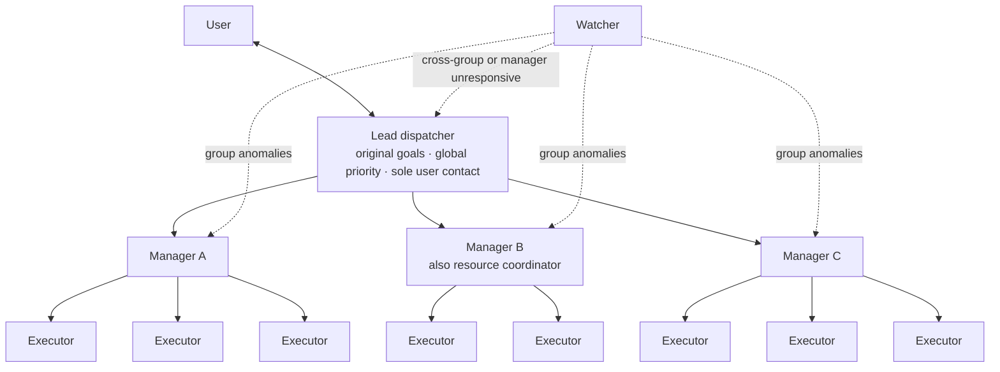
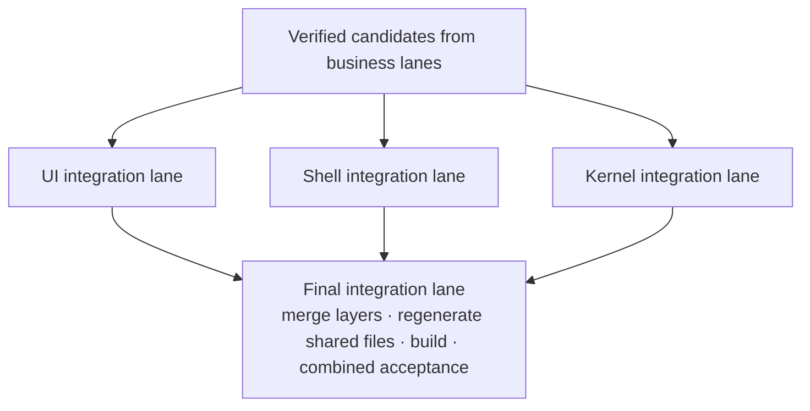

# Multi-Manager Dispatch Architecture

[中文](../manager-architecture.md)

The lead dispatcher handles only the human and the big picture. Managers lead the executors. Resources and integration each have their own coordinator. We use this structure in real development at APlus, and it took the number of execution lines we can coordinate effectively from about ten to about fifty.

## Why add a layer

With a single lead dispatcher, things started to fall apart at a dozen or so agents and about ten execution lines. Executors had finished and machines were idle, but the next step did not start.

The first idea was a watcher that reminds the dispatcher promptly. It did not solve the problem. Reminders only make the backlog visible sooner; every delivery still goes through the same entry point, where the dispatcher reads, judges, and arranges each one in turn.

**The bottleneck is how many deliveries the dispatcher can process per turn, not how many executors there are.** The only fix is more agents that can process deliveries.

## Structure

| Role | Responsible for | Does not |
| --- | --- | --- |
| Lead dispatcher | Talking to the user; holding the original goals and global priority; resolving cross-group conflicts; reviewing at key points | Receive every executor delivery or reread every execution log |
| Manager | Leading its executors: dispatch, check deliveries, review, follow up, and chase each user problem to real acceptance | Exceed its group's write ownership or resource share |
| Resource coordinator | An existing manager doubling up; watches real-time load on all approved machines and gives each group a share | Perform the executors' concrete operations |
| Executor | Locating, implementing, and verifying its own line; stays responsible for the same problem | Pick its own machine or edit files owned by others |
| Watcher | Checks only for missed handoffs and unowned work, reporting first to the owning manager | Dispatch work, change ownership, or acknowledge on anyone's behalf |

## Six rules that keep it from falling apart

1. **Manager capacity counts every open item.** Queued, awaiting verification, awaiting integration, and waiting on external input all take a manager's attention. Handing in source code does not free a slot. This round used at most ten open lines per manager; that is a tested configuration, not a limit.
2. **Routine deliveries close at the manager layer.** Executors save results before notifying their manager, and the manager acknowledges a delivery only after the next step is in place. Routine follow-up does not pass through the lead dispatcher.
3. **Everything has exactly one owner.** Only one manager consumes a task's deliveries, and only one writer touches a file at a time.
4. **Resources are allocated centrally, counting tasks dispatched but not yet started.** Business managers pick machines within their share; executors do not choose. Agent slots, per-machine load, file write ownership, and desktop focus are accounted separately, and when one is constrained only the affected step waits.
5. **Goals must not shrink layer by layer.** At key points the lead dispatcher checks "what did the user originally want, and what is being delivered now", so that small cuts at each layer do not add up to a result that passes technically but is useless to the user.
6. **Group by backlog, not by department.** Start with three layers. When deliveries pile up, split a group or add resources first; add a layer only for an independent sub-goal. Retire idle managers when their work ends.

## Remove one bottleneck and the next appears: integration

Once execution was grouped, dozens of lines could deliver at once, and candidates queued at the single integration owner instead. So integration was split into lanes by file set as well:

Each integration lane writes only its own file set. Shared manifests, dependency lock files, and generated artifacts are written only by the final lane. Reviews and real-operation checks already done in business lanes are not repeated; only interactions that can appear after merging are checked.

## Results

- Effective collaboration grew from about ten execution lines to about fifty, with about fifty agents running concurrently and still working smoothly.
- In one large refactor, work the owner estimated would take a traditional team several weeks had its first round finished in a little over three hours.

These are the owner's observations in practice, not a controlled benchmark. A roughly fivefold increase in collaboration scale does not mean five times the output per unit of time.

## Costs

- Each extra layer adds one more relay and one more wait.
- Managers themselves occupy agent slots and consume tokens.
- A manager's context also fills up; how many lines it can lead depends on task complexity and follow-up speed.
- Hierarchies naturally tend to narrow the goal at each layer, so the lead dispatcher's review cannot be skipped.

## Not yet verified

- No controlled comparison of flat vs layered dispatch on the same batch of tasks.
- No systematic measurement yet of delivery-to-follow-up latency, backlog size, duplicate executions, or token cost.
- Whether managers resume automatically after a conversation closes or the app restarts depends on the host tool and must be verified separately.

## Trying it

Start with two managers, each leading two or three executors. First use two harmless small tasks, as in the [host adaptation notes](../../skills/reliable-agent-dispatch/references/host-adaptation.md) (Chinese), to verify that deliveries reach the manager, the manager actually continues the work, and work below keeps going while the lead dispatcher talks to the user. Scale up only after that passes and deliveries really are piling up.

Detailed duties are in the [manager and integration notes](../../skills/reliable-agent-dispatch/references/manager-hierarchy.md) (Chinese). The pitfalls hit before layering are in sections 1–7 of the [workflow article](workflow-evolution.md); layering itself is in sections 8–9.
