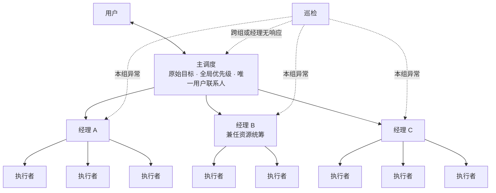
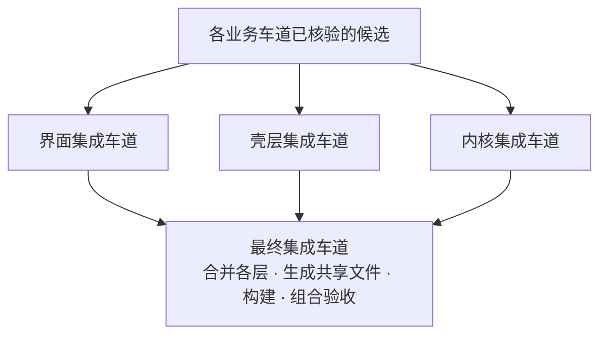

# 多经理调度架构

[English](en/manager-architecture.md)

主调度只管人和全局，经理带执行者，资源和集成各有统筹。我们在 APlus 的真实开发里用这套结构，让同时协作的执行线从约十条扩到约五十条。

## 为什么要分层

只有一个主调度时，十几个代理、约十条执行线就开始脱节：执行者做完了，机器也空着，下一步却迟迟不动。

第一反应是加一个巡检，及时提醒主调度。试过以后发现不解决问题。提醒只能让积压更早被看见；所有交付仍然挤进同一个入口，由主调度逐条读、逐条判断、逐条安排。

**瓶颈是主调度每一轮能处理多少交付，而不是执行者有多少。** 要解决它，只能增加能处理交付的人。

## 结构

| 角色 | 负责什么 | 不做什么 |
| --- | --- | --- |
| 主调度 | 对接用户；守住原始目标和全局优先级；裁决跨组冲突；关键节点复核 | 不逐条收执行者交付，不重读全部执行日志 |
| 经理 | 带本组执行者：派单、核交付、审查、续派，把同一个用户问题追到真实验收 | 不越过本组写权和资源份额 |
| 资源统筹 | 由一位现有经理兼任；统一看所有获准机器的实时负载，给各组划份额 | 不替执行者做具体操作 |
| 执行者 | 完成本线的定位、实现和验证，同题持续负责 | 不自己挑机器，不改别人负责的文件 |
| 巡检 | 只查漏接和无人接续，先报所属经理 | 不派活、不改归属、不代确认 |

## 让它不散架的六条规则

1. **经理容量算所有未结项。** 排队、待验证、待集成、等外部输入都占经理的注意力。交出源码不等于腾出名额。本轮每位经理最多带十条，这是实测配置，不是上限。
2. **日常交付在经理层闭环。** 执行者先保存结果再通知经理；经理接上下一步之后才确认这条交付。日常接续不经过主调度。
3. **每样东西只有一个负责人。** 一个任务只由一位经理消费交付，一个文件同时只有一个写入者。
4. **资源统一分配，并计入已派出、尚未启动的任务。** 业务经理在自己的份额内指定机器，执行者不自己挑。代理名额、每台机器的负载、文件写权和桌面焦点分开计算，一项受限只排队受影响的步骤。
5. **目标不能逐层收窄。** 主调度在关键节点核对“用户原来要什么、现在交出来的是什么”，不让每一层各砍一点，最后交出一个技术上通过、用户用不上的结果。
6. **按积压分组，不按部门。** 先用三层；交付积压了先拆组或补资源，有独立子目标再考虑加层。任务结束就收回空闲的经理。

## 拆掉一个瓶颈，下一个就出现：集成

执行分组以后，几十条线可以同时交付，候选又在“唯一集成负责人”那里排起长队。于是集成也按文件分车道：

每条集成车道只写自己的文件集合。共享清单、依赖锁文件和生成产物只由最终车道写。业务车道已经做过的审查和实测不再重做，只检查合并以后才可能出现的相互影响。

## 效果

- 有效协作的执行线从约十条扩到约五十条，约五十个代理同时运行仍然顺畅。
- 一次大重构，负责人估计传统团队要几周，首轮三个多小时完成。

这些是负责人的实际观察，不是受控基准。协作规模扩大约五倍，不等于单位时间产出也是五倍。

## 代价

- 每多一层，就多一次转述和等待。
- 经理本身占代理名额，也消耗 token。
- 经理的上下文同样会满，带多少条要按任务复杂度和接续速度调整。
- 分层天然容易逐层收窄目标，所以主调度的复核不能省。

## 还没验证的

- 没有在同一批任务上做过“不分层”和“分层”的对照。
- 交付到接续的间隔、积压数量、重复执行次数和 token 成本，还没有系统统计。
- 对话关闭或应用重启以后经理能否自动恢复，取决于所用的工具，需要单独验证。

## 想试的话

从两位经理、各带两三个执行者开始。先按[宿主适配说明](../skills/reliable-agent-dispatch/references/host-adaptation.md)用两个无害的小任务验证：交付能送到经理，经理能真正续派，主调度和用户聊天时下面的工作不停。验证通过、交付确实积压了，再扩规模。

更细的职责划分见[经理制与集成说明](../skills/reliable-agent-dispatch/references/manager-hierarchy.md)。分层之前踩过的坑见[演进文章](workflow-evolution.md)第 1–7 节，分层本身见第 8–9 节。
